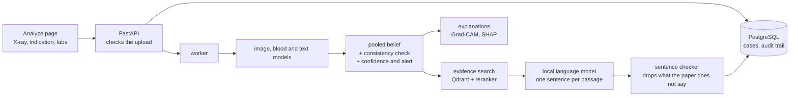

# MedReason-AI

[](https://github.com/adieladaniel/medreason-ai/actions/workflows/tests.yml)


A multimodal medical AI service, built end to end as a final-year learning project. Given a chest X-ray, the blood labs on record and the
clinical indication for the exam, it predicts **Normal, Pneumonia or Lung Cancer**, shows how each input moved the answer, says how sure it
is, and adds cited background from published papers.

It demonstrates how to build such a system properly: models, explanations, calibrated uncertainty, retrieval, an API, a database,
containers and tests. It is **not a clinical tool**, its numbers are modest, and they are reported as they are.

## How it works



The trained models diagnose, an orchestrating layer reasons about their outputs, and retrieval only explains. Retrieval can never change the
predicted label, and the language model never sees the patient's case, only one retrieved passage at a time.

- **Three models, one answer.** A frozen chest X-ray network (torchxrayvision, trained on MIMIC-CXR) with a small head, gradient-boosted trees
  on 17 lab values and two ratios, and a frozen Bio_ClinicalBERT on the indication text. Their probabilities are combined by a geometric mean.
- **Explanations for each input.** Grad-CAM on the film, SHAP on the labs, word-level SHAP on the text.
- **Uncertainty that was measured.** Calibrated probabilities, an "Uncertain" headline for low-confidence cases, prediction sets ("it could be
  one of these"), and a separate cancer alert.
- **Cited evidence, checked.** Hybrid search over 44 open-access papers, a medical cross-encoder reranker, one sentence per passage from a
  local 3B model, and a sentence-level entailment check that removes what the paper does not say.
- **Safeguards.** The server refuses uploads that are clearly not an X-ray, says when no passage supports a finding, and marks cases it cannot
  assess.

## Results

Scored once on a sealed test split of 2,099 studies from 721 patients who appear nowhere in training or validation:

| | Sealed test | Validation |
|---|---|---|
| macro F1 | **0.609** (0.559 to 0.654) | 0.613 |
| F1 Normal / Pneumonia / Lung Cancer | 0.629 / 0.775 / 0.421 | 0.615 / 0.797 / 0.426 |
| accuracy (always answering Pneumonia scores 0.628) | 0.704 | 0.719 |
| Lung Cancer ROC AUC | 0.841 (0.767 to 0.904) | 0.853 |
| calibration error, raw / after temperature scaling | 0.118 / 0.029 | 0.142 / 0.026 |

Intervals are 95 percent and resample patients. The validation numbers held up on unseen patients.

**Safeguards on the sealed test split:**

| | Result |
|---|---|
| Low-confidence rule | answers 81.9 percent of cases; accuracy on those is 75.2 percent (70.4 percent on all) |
| Prediction sets at 80 percent | the true class is inside the set for 81.4 / 79.4 / 80.8 percent of Normal / Pneumonia / Lung Cancer studies |
| Cancer alert (default) | flags 56.7 percent of true cancers at 11 alerts per 100 cases, 29 percent of them real |
| Consistency check: all three agree / two agree / all three differ | 85.5 / 64.2 / 53.7 percent correct |

**Evidence retrieval** (44 papers, 811 passages; 54 answerable queries split into dev and test by topic, plus 16 off-corpus queries):

| | Dev (26 queries) | Test (28 queries) | All 54 |
|---|---|---|---|
| right passage first (hit@1) | 1.00 | 0.893 | 0.944 |
| right passage in the top 3 (hit@3) | 1.00 | 0.964 | 0.981 |
| mean reciprocal rank (MRR) | 1.00 | 0.938 | 0.968 |
| nDCG@5 | 0.971 | 0.873 | 0.921 |

The adopted pipeline is hybrid search (dense plus BM25), then a MedCPT cross-encoder reranks the top 5. On the same queries, semantic search
alone scored hit@1 0.57 on the test half and keyword search alone 0.71. The reranker's score also decides when to say "no evidence": it separates
answerable from off-corpus queries with ROC AUC 0.997, refused 16 of 16 off-corpus queries and kept 53 of 54 answerable ones. Of the sentences the
3B model wrote, 73 percent passed the entailment check and the rest were removed. Relevance here is a keyword proxy that was audited by hand, and
one query moves a half by about 4 points ([details](experiments/rag_retrieval/PIPELINE.md)).

**Where it fails, in short:**

- The text input (mostly the referring clinician's suspicion in words) carries the result, and the image adds almost nothing on the test split.
- It cannot say "none of these" for other lung disease. Two pre-registered attempts to add that (a gate on the models' outputs, and retraining
  the models with an explicit "other" class) both failed their rules and are reported as negative results.
- One hospital system, labels built from billing codes and report mentions, and the evidence layer is the least validated part.

**Read [docs/RESULTS.md](docs/RESULTS.md) before quoting any number.**

## Quick start

A fresh clone contains the code, the tests, the committed result files and the dashboard data. It does **not** contain the MIMIC-derived data or the
trained models (PhysioNet credentialed data may not be redistributed; see below), so on its own it can:

- run the test suite, which uses synthetic data and stub models: `pip install -r requirements.txt` then `python -m pytest`
- show the progress dashboard from the committed results: `python -m uvicorn app.main:app --port 8000`, then open http://localhost:8000
- build and test the container image: `docker build --target test .`

Predicting a case needs the trained models under `experiments/`, which you can rebuild from your own PhysioNet access (next section). With them in
place, the full stack runs in containers; first-time setup (a one-time model download and building the evidence index) is in
[docs/DOCKER.md](docs/DOCKER.md):

```bash
cp .env.example .env            # set POSTGRES_PASSWORD
docker compose up -d            # API, PostgreSQL, Qdrant. Ollama (llama3.2) runs on the host: ollama serve
# open http://localhost:8000/#/analyze
```

Every port is bound to 127.0.0.1 because there is no login. This is a local demonstration and must not be given real patient data.

## The Analyze page and the API

Upload a chest X-ray, type an indication and enter any labs (all optional, at least one needed). The prediction appears in about half a second,
then the explanations, then the cited evidence note as each stage finishes. Interactive API docs are at `/docs`.

| Endpoint | Purpose |
|---|---|
| `POST /api/cases` | submit a case (multipart: image, indication, labs as JSON); answers 202 with a case id |
| `GET /api/cases/{id}` | whatever stage results exist so far |
| `GET /api/cases/{id}/stream` | follow the case live (server-sent events) |
| `GET /api/cases/{id}/events`, `/llm-calls` | audit trail and every language-model prompt |
| `DELETE /api/cases/{id}` | delete a case (cases are deleted after 30 days anyway) |
| `GET /api/input-spec` | lab names, units and limits the form is built from |
| `GET /api/health`, `/api/ready`, `/api/stats` | liveness, readiness of every dependency (`ok`, `degraded`, `down`), and timings per stage |

Uploads are checked before anything is stored: PNG or JPEG decided from the bytes, size and pixel limits, known lab names only, and a guard that
refuses what is clearly not a radiograph (0.35 percent of real validation films were wrongly refused). Logs carry a case id and a request id on
every line (`MEDREASON_LOG_FORMAT=json` for JSON lines) and never contain typed text or lab values.

## Engineering

- **Staged pipeline.** The prediction is stored and shown first; explanations and the evidence note follow. A failure after the first stage
  leaves the case "partial" with everything before it. Every model call is stored with its prompt.
- **Tests.** 538 tests (plus 66 slow ones: browser, Postgres, real-model rehearsals) run without models or services. New behaviour comes with a
  test, and the tests were checked by breaking the code on purpose.
- **CI.** The `tests` job builds the image and runs the suite inside it from a clean checkout. The `stack` job starts PostgreSQL, Qdrant and the API,
  migrates a database made by an older version, runs a smoke test, restarts the API and checks again.
- **Reproducible builds.** Every dependency is pinned with file hashes (`requirements-api.lock`, installed with `--require-hashes`), torch is the CPU
  wheel, and the container is non-root and offline at run time.
- **Schema migrations** with Alembic, run at startup, with a test that fails if a model change ships without a migration.
- **Honest evaluation.** Five evaluations with a plan written before they ran: the sealed test split (scored once), an image-backbone swap, a
  measurement of other lung disease, an out-of-scope gate, and a four-class retrain. Three came out negative and are reported.

## Demo cases

`python scripts/build_demo_cases.py` picks nine validation cases by fixed rules (never from the test split) and freezes them in `demo/cases/`,
which is git-ignored because it holds MIMIC images and clinical text. They appear in the Analyze page's "Example case" menu, and each answers a
question: an easy Normal and Pneumonia, a Lung Cancer found, models that disagree, a case the system is unsure about, no labs on record, a mistake
the safeguards catch, a cancer only the alert catches, and a mistake they miss. Two built-in pictures that are not X-rays show the refusal.
`python scripts/rehearse_demo.py --url http://127.0.0.1:8000` runs all nine through a live stack and compares each with its frozen values.

The MIMIC licence does not clearly allow showing its films or text in public, so these cases are for private use. [docs/DEMO_SCRIPT.md](docs/DEMO_SCRIPT.md)
has a recording plan that uses a public-domain film and typed inputs instead.

## Documentation

| | |
|---|---|
| [docs/RESULTS.md](docs/RESULTS.md) | the honest summary: numbers on unseen patients, what each part contributes, where it fails, what did not work |
| [docs/DOCKER.md](docs/DOCKER.md) | running the stack, the reasons for each container choice, what was measured |
| [docs/PHASE7_DESIGN.md](docs/PHASE7_DESIGN.md) | the backend design and the reasons for each choice |
| [docs/DEMO_SCRIPT.md](docs/DEMO_SCRIPT.md) | what may appear on screen, and an 80-second recording plan |
| `experiments/<name>/` | each evaluation, with the plan written before it ran where there was one, and its results (`test_evaluation`, `image_backbones`, `other_pathology`, `out_of_scope`, `v2_four_class`, `e2e`, `rag_retrieval`, `uncertainty`) |

## Reproducing the data and models

The dataset is built from MIMIC-CXR and MIMIC-IV v3.1 (PhysioNet credentialed data). The licence does not permit redistributing the data or
identifier-carrying derivatives, so `data/`, the processed tables, cached embeddings, trained models and per-study predictions are all git-ignored.
To reproduce the work, get your own PhysioNet credentials, place the sources under `data/raw/` and run:

```bash
python -m venv .venv && .venv/Scripts/activate      # Windows
pip install -r requirements.txt
python -m spacy download en_core_web_sm

# link studies to admissions, label them, build and split the dataset
python scripts/exploration/check_linking_feasibility.py
python scripts/exploration/map_disease_labels.py
python scripts/exploration/save_resolved_links.py
python scripts/exploration/label_reports.py
python scripts/exploration/build_final_labels.py
python scripts/build_final_dataset.py
python scripts/split_dataset.py

# models
python scripts/train_blood_baseline.py
python scripts/train_text_baseline.py
python scripts/generate_oof_predictions.py
python scripts/train_fusion.py                       # needs the image out-of-fold predictions from Kaggle
python scripts/build_decision_rules.py               # confidence, prediction-set and cancer-alert rules

# evidence library and index
python -m app.rag.build_corpus      # downloads the open-access papers listed in app/rag/corpus_sources.json
python -m app.rag.index --build     # embeds them into the local Qdrant folder
```

The image model is trained on Kaggle's free GPU, driven by the `kaggle` CLI against `kaggle_upload/baseline_kernel/` (frozen backbone features
are extracted once, then the head trains on cached 18-number inputs). To look at one case from the command line:

```bash
python -m app.agent.orchestrator --study-id <STUDY_ID>
python -m app.rag.explain_case --study-id <STUDY_ID>        # needs Ollama running with llama3.2
```

The dataset in short: 15,453 studies from 4,803 patients (Pneumonia 10,165, Normal 4,277, Lung Cancer 1,011), each a chest X-ray, its report and
the blood panel of the linked hospital admission. Labels come from diagnosis codes or a negation-aware reading of the report. Studies with some
other finding were dropped. The split is by patient (70/15/15), so nobody appears in two splits.

## Repository layout

```
app/                    FastAPI app, dashboard, agent, evidence retrieval, storage
  agent/                 belief state, consistency check, missing-information planner, confidence rules
  rag/                   corpus builder, hybrid retrieval, evidence planner, writer, sentence checker, evaluations
  pipelines/             the staged pipeline and the background worker
  database/              tables, sessions, repository, migrations runner
  api/                   case endpoints, input validation, example cases
  static/                the Analyze page and the dashboard (plain JavaScript, no build step)
explain/                Grad-CAM, SHAP and word-attribution explainers
scripts/                data pipeline, training, evaluations, demo and CI helpers
experiments/            plans and results of every evaluation (weights and per-study predictions are git-ignored)
kaggle_upload/          image-model training, runs on Kaggle's free GPU
migrations/             Alembic schema migrations
tests/                  538 tests, no models or services needed
docs/                   results, container notes, backend design, demo plan
Dockerfile, docker-compose.yml, requirements-*.txt|lock    container build, stack and pinned dependencies
```

## Licence

The code is released under the [MIT licence](LICENSE). That covers the code in this repository only:

- The MIMIC-CXR and MIMIC-IV data, and anything derived from them, are PhysioNet credentialed data under their own licence and are not included.
- The open-access papers behind the evidence library are not included either; each keeps its own licence (the corpus builder admits only CC BY, CC BY-NC, CC BY-NC-SA and CC0 papers).
- Third-party files in `app/static/vendor/` keep their own licences: Chart.js (MIT) and the Inter typeface (SIL Open Font Licence, `app/static/vendor/inter/LICENSE.txt`).
- The pretrained models it downloads (torchxrayvision, Bio_ClinicalBERT, MedCPT, DeBERTa, Llama 3.2) are under their publishers' licences.
