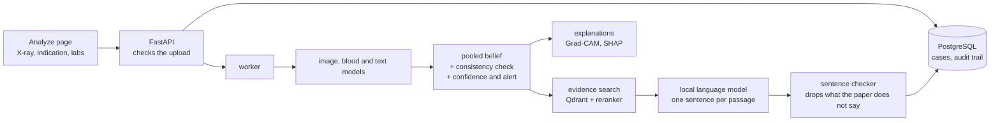

# MedReason-AI

[](https://github.com/adieladaniel/medreason-ai/actions/workflows/tests.yml)

A multimodal medical AI service, built end to end as a learning project: given a chest X-ray, the blood labs on record and the clinical
indication for the exam, it predicts **Normal, Pneumonia or Lung Cancer**, shows how each input moved the answer, says how sure it is, and
adds cited background from published papers. It is a demonstration of how to build such a system properly (models, explanations,
uncertainty, retrieval, an API, a database, containers, tests), **not a clinical tool**. Its numbers are modest, and they are reported as they are.



The trained models diagnose, an orchestrating layer reasons about their outputs, and retrieval only explains: it can never change the
predicted label.

## The result, honestly

Scored once on a sealed test split of 2,099 studies from 721 patients who appear nowhere in training:

| | Sealed test | Validation |
|---|---|---|
| macro F1 | **0.609** (0.559 to 0.654) | 0.613 |
| F1 Normal / Pneumonia / Lung Cancer | 0.629 / 0.775 / 0.421 | 0.615 / 0.797 / 0.426 |
| accuracy (always saying Pneumonia scores 0.628) | 0.704 | 0.719 |
| calibration error after temperature scaling | 0.029 | 0.026 |

The validation numbers held up on unseen patients. The caveats matter as much as the table: the text input (mostly the referring clinician's
suspicion in words) carries the result, the image adds almost nothing on test, the system cannot say "none of these" for other lung disease,
and it is one hospital system with noisy labels. **Read [docs/RESULTS.md](docs/RESULTS.md) before quoting any number.**

## Try it

```bash
docker compose up -d          # API, PostgreSQL, Qdrant; first-time setup is in docs/DOCKER.md. Ollama runs on the host.
# open http://localhost:8000/#/analyze and pick an example case from the menu
```

Or without Docker: `python -m uvicorn app.main:app --port 8000`. The menu offers curated validation cases (built by
`python scripts/build_demo_cases.py`, see the demo guide below) and two pictures that are not X-rays, to show the refusal.

## Status

| Phase | State |
|-------|-------|
| 0. Vision and scope | done |
| 1. Data foundation | done, 15,453-sample joined dataset |
| 2. Unimodal baselines | done, image 0.50 (0.48 without augmentation, as used in fusion) / blood 0.46 / text 0.51 (validation macro F1) |
| 3. Multimodal fusion | done, validation macro F1 0.61, sealed test 0.61 |
| 4. Explainability | core done (SHAP + Grad-CAM per modality) |
| 5. Agentic layer | core done (belief state, consistency checker, missing-information planner, confidence and cancer alert) |
| 6. RAG evidence retrieval | done (44-paper library, hybrid search with reranking, constrained writer, faithfulness check) |
| 7. Backend and API (FastAPI, PostgreSQL, Qdrant, Docker) | done (API, Analyze page, observability, containers, end-to-end run) |
| 8. Integration, testing, writeup | done: sealed test run once, non-X-ray guard, other-pathology measurement, demo cases, results write-up |

Each phase is described in [ROADMAP.md](ROADMAP.md), the project brief is [CLAUDE.md](CLAUDE.md), and the Phase 7 design and its reasons are in
[docs/PHASE7_DESIGN.md](docs/PHASE7_DESIGN.md). The experiments, each with the plan written before it ran and its results, are under
`experiments/` (`test_evaluation`, `image_backbones`, `other_pathology`, `e2e`, `xray_guard`).

## Progress dashboard

A local web UI that shows everything done so far: phase tracker, data pipeline
statistics, per-model results and training curves, fusion comparisons (ROC, precision
recall, calibration, confusion matrices), the explainability gallery, the evidence
retrieval results, and a reliability page (confidence intervals, calibration, abstention).

```bash
python -m uvicorn app.main:app --port 8000
# then open http://localhost:8000
```

It reads the real result files under `experiments/` and rebuilds its data file
(`app/data/dashboard.json`) on startup when a source is newer, so new results show up
without editing the UI. The gallery needs `experiments/explain_samples/`, which is
git-ignored.

## Case API

The same server runs a case through the pipeline in the background. Start Ollama first if you want the written
note (`ollama serve`), then:

```bash
python -m uvicorn app.main:app --port 8000
```

Open http://localhost:8000/#/analyze for the Analyze page: upload a chest X-ray, type an indication, enter any
labs, and watch the prediction, the explanations and the cited evidence fill in as each stage finishes. The
interactive API documentation is at http://localhost:8000/docs, where `POST /api/cases` can be tried with a file
upload. It takes a chest X-ray (PNG or JPEG), a clinical indication and lab values as a JSON object, any of them
optional but at least one, and answers at once with a case id. `GET /api/cases/{id}` shows whatever stage results
exist so far (the prediction arrives first, then explanations, then the cited evidence), and
`GET /api/cases/{id}/stream` follows it live. Cases are deleted after 30 days, or at once with
`DELETE /api/cases/{id}`. The prediction also says how sure it is: a low-confidence case is headlined "Uncertain", a
prediction set lists every class that cannot be ruled out, and a possible lung cancer signal is flagged separately
when the models' combined probability is high enough, because averaging the three models alone misses cancers the text
model finds. The rules come from `app/data/decision_rules.json` (rebuild with `python scripts/build_decision_rules.py`),
and `MEDREASON_CANCER_ALERT_RECALL` (0.5 to 0.8) sets how many false alarms are accepted to catch more cancers.
There is no login: this is a local demonstration and must not be given real patient
data.

Running it: three endpoints say how the service is doing. `GET /api/health` only says the process answers.
`GET /api/ready` probes the database, the worker thread, the evidence index and Ollama (with the configured model
pulled) and answers `ok`, `degraded` (the prediction would still work, only the written evidence note would be
missing; HTTP 200) or `down` (no case could run; HTTP 503). `GET /api/stats` gives cases by status and the median,
95th percentile and worst seconds of each stage. Logs carry the case id and a request id on every line, from any code
that runs for that case; set `MEDREASON_LOG_FORMAT=json` for one JSON object per line, and start uvicorn with
`--no-access-log` so its own request lines do not duplicate the app's. Logs record which inputs were sent, never the
typed text or the lab values.

## Demo guide

`python scripts/build_demo_cases.py` picks nine validation cases by fixed rules (never from the test split) and freezes them in `demo/cases/`
(git-ignored: MIMIC images and clinical text). Each answers a question, and two of them show where the safeguards fail on purpose.
They appear in the Analyze page's "Example case" menu; choosing one fills the X-ray, the indication and the labs together.

| Case | The question it answers |
|---|---|
| A clear Normal; a clear Pneumonia | What does an easy, confident answer look like, with all three inputs agreeing? |
| A Lung Cancer the system finds | Does it ever find the rare class with confidence? |
| The three models disagree, and the pooled answer is right | What happens when the inputs conflict? |
| A case the system is not sure about | How does it behave when it should not be trusted? (headlined Uncertain) |
| No blood tests on record | Does it still work with an input missing? |
| Wrong, but the system says it is unsure | Do the safeguards catch a mistake? |
| A cancer the headline misses, and the alert catches | What is the separate cancer alert for? |
| Wrong, and the system does not know it | Where do the safeguards fail? |
| Not an X-ray: a colour picture; random noise | Does the server refuse what is not a radiograph? |

Before presenting: start Ollama and send one case first, because the first language-model call after Ollama starts takes about 20 seconds
while it loads the model; a full note then takes 15 to 20 seconds, and the prediction itself appears in under a second. Delete test cases
afterwards from the page (each is deleted automatically after 30 days). The expected outcome of every demo case is kept beside it in
`demo/cases/manifest.json`, and a test checks that the live system still reproduces all nine.

## Running in containers

`docker compose up -d` runs the API, PostgreSQL and a Qdrant server (Ollama stays on the Windows host). The image holds code
only; the trained models are mounted read-only and the pretrained downloads live in volumes, so a one-time setup fetches them
and fills the evidence index. Every port is bound to 127.0.0.1 because there is no login. The commands, the reasons for each
choice and what was measured are in [docs/DOCKER.md](docs/DOCKER.md). `docker build --target test .` runs the whole test
suite in a clean image and is what the CI workflow does. `python scripts/run_e2e.py --server http://127.0.0.1:8000` sends 16
validation studies chosen by rule through the running service, checks each against its offline twin and writes the timing
budget (results in [experiments/e2e/RESULTS.md](experiments/e2e/RESULTS.md)).

To look at a real case without typing 13 lab values, send a validation case to the running server and open the address it
prints. Everything comes from the same study, which is what the models were built for:

```bash
python scripts/submit_case.py --study-id 53383543     # a pneumonia case
python scripts/submit_case.py --study-id 57386788     # a normal case (this one has no lab values on record)
python scripts/submit_case.py --study-id 50262066     # a lung cancer case the models get wrong, flagged as a conflict
```

Mixing one patient's X-ray with another's typed values makes the text and blood models outvote the image, so every case comes out
Pneumonia; that is the fusion working, not a bug, and it is why the page's example menu loads a complete case (X-ray, indication and labs from
the same study) instead of a button that filled in made-up values. The helper offers only the training and validation splits: the test split was
sealed until the one final evaluation and is now used up (see `docs/RESULTS.md`).

## Data is not included in this repo

The dataset is built from MIMIC-CXR and MIMIC-IV v3.1 (PhysioNet credentialed data). The
license does not permit redistributing the data or identifier-carrying derivatives, so
`data/`, the processed CSVs, cached embeddings, and per-study prediction files are all
git-ignored. To reproduce the work, obtain your own PhysioNet credentials, download the
sources, and run the pipeline below.

How the dataset is built (the linking algorithm, the label rule, the blood-feature tiers)
is documented in [CLAUDE.md](CLAUDE.md) section 3.

## Layout

```
scripts/               data pipeline, run from repo root, local, no GPU
  exploration/          feasibility probes, disease mapping, report labeler, label builder
  build_final_dataset.py / split_dataset.py
  train_blood_baseline.py    blood/tabular baseline (sklearn, local CPU)
  train_text_baseline.py     text baseline (frozen Bio_ClinicalBERT + logreg, local CPU)
  generate_oof_predictions.py / train_fusion.py    Phase 3 fusion
explain/               Phase 4 per-modality explainers (SHAP, Grad-CAM)
app/                   FastAPI app, progress dashboard, agent, evidence retrieval, storage
  agent/                orchestrator, belief state, consistency checker, missing-information planner
  rag/                  corpus builder, hybrid retrieval, evidence planner, writer, faithfulness check, evaluations
  database/             Phase 7 storage: tables, sessions, repository
  config.py             settings from MEDREASON_* environment variables
  observability.py      logs tagged with the case id and request id (text or JSON)
  health.py             readiness probes (database, worker, evidence index, Ollama) and usage numbers
  prefetch.py           one-time download of the pretrained models for the offline container
  xray_guard.py         refuses uploads that are clearly not a radiograph (fitted by scripts/build_xray_guard.py)
  api/examples.py       the Analyze page's example-case menu
tests/                 461 tests (plus 66 slow ones: browser, Postgres, rehearsals), no models or services needed (python -m pytest)
Dockerfile, docker-compose.yml, requirements-api.txt, .dockerignore, .github/workflows/tests.yml    container build, stack and CI
requirements-api.lock, requirements-test.lock   every dependency pinned with file hashes, made by scripts/lock_dependencies.py
alembic.ini, migrations/                       schema migrations, run at startup by app/database/migrate.py
scripts/smoke_stack.py, scripts/ci_stack.sh   smoke test of a running stack, and the script CI runs to start and check it
docs/                  Phase 7 design, machine and environment notes
kaggle_upload/         image-model training, runs on Kaggle free GPU, not locally
experiments/           baseline results (RESULTS.md, metrics.json). Weights and per-study preds git-ignored
data/                  git-ignored (see above)
```

## Setup

```bash
python -m venv .venv && .venv/Scripts/activate      # Windows
pip install -r requirements.txt
python -m spacy download en_core_web_sm
```

## Pipeline (after placing the MIMIC sources under `data/raw/`)

```bash
python scripts/exploration/check_linking_feasibility.py
python scripts/exploration/map_disease_labels.py
python scripts/exploration/save_resolved_links.py
python scripts/exploration/label_reports.py
python scripts/exploration/build_final_labels.py
python scripts/build_final_dataset.py
python scripts/split_dataset.py

python scripts/train_blood_baseline.py
python scripts/train_text_baseline.py
python scripts/generate_oof_predictions.py
python scripts/train_fusion.py                       # needs image OOF preds from Kaggle
```

Image-model training is driven through the `kaggle` CLI against
`kaggle_upload/baseline_kernel/`. See [CLAUDE.md](CLAUDE.md) section 4.

Build the evidence library and its index, then run the tests:

```bash
python -m app.rag.build_corpus      # downloads the open-access papers listed in app/rag/corpus_sources.json
python -m app.rag.index --build     # embeds them into the local Qdrant folder
python -m pytest                    # under a minute
```

Run one case through the agent and the evidence chain (the text explanation step takes under a second for a typical
indication and up to about 15 seconds for a very long one, and the writer needs Ollama running with `llama3.2`):

```bash
python -m app.agent.orchestrator --study-id 53383543
python -m app.rag.explain_case --study-id 53383543
```
